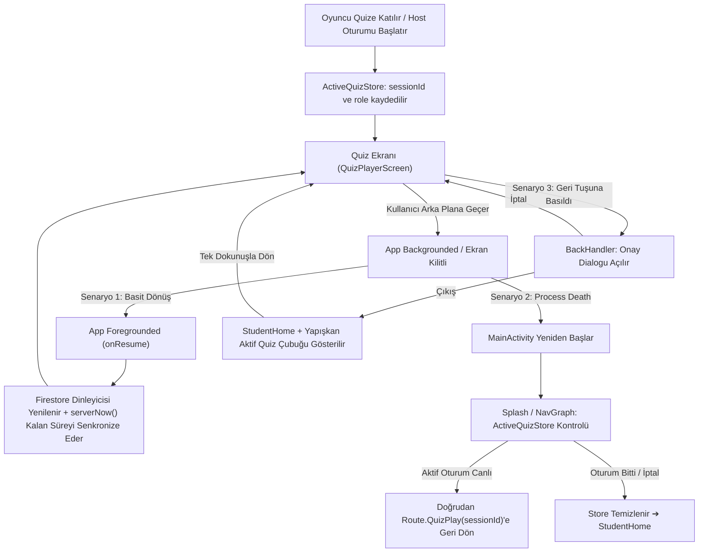

# Good4 Canlı Quiz — Arka Planda Kalıcılık ve Oturum Koruma Planı (Background Persistence & Resilience)

## 1. Amaç ve Kapsam

Bu plan, **Good4 Topluluk Canlı Quiz** oyunu sırasında oyuncunun (veya oturum yöneticisinin) uygulamayı arka plana alması, telefonunu kilitlemesi, başka bir uygulamaya geçmesi veya işletim sisteminin bellek baskısı (Process Death) nedeniyle uygulamayı kapatması durumunda **oturumun ve oyun ekranının kaybolmamasını** sağlamak üzere hazırlanmıştır.

Mevcut MVP mimari kurallarına (`.agents/skills/good4-live-quiz/SKILL.md`, `AGENTS.md`) ve maliyet kılavuzlarına (`good4-firebase-guardrails`) tam uyumlu kalınacak; gereksiz listener/soket maliyeti üretilmeyecektir.

---

## 2. Kök Neden Analizi (Root Causes)

| Problem | Neden | Etki |
| :--- | :--- | :--- |
| **Android Process Death** | Kullanıcı ağır bir uygulamaya geçtiğinde veya telefon kilitliyken sistem RAM'i boşaltmak için Good4 sürecini öldürür. | Uygulama baştan başlar (`Route.Splash` ➔ `StudentHome`), NavGraph yığını sıfırlanır, quiz ekranı tamamen kaybolur. |
| **Kazara Geri Çıkış** | `QuizPlayerScreen` ve `QuizHostScreen` üzerinde `BackHandler` (sistem geri tuşu dinleyicisi) yoktur. | Kullanıcı kenardan geri kaydırdığında veya yanlışlıkla geri bastığında soru/lobi ekranından anında çıkar, geri dönüş yolu bulamaz. |
| **Görsel Geri Dönüş Eksikliği** | Ana ekranda (`StudentHomeScreen`) veya Topluluk sayfasında devam eden oturumu gösteren yapışkan bir çubuk yoktur. | Kullanıcı bir bildirimle veya kasıtlı olarak ana sayfaya gitse bile quize dönebileceği bir UI bileşeni bulunmaz. |
| **Canlı Oyun Zaman Akışı** | Canlı quiz senkron ve host-paced bir oyundur (soru süresi 10–30 sn). | Arka planda kalındığında sunucu süresi işlemeye devam eder. Kullanıcı döndüğünde zaman aşımına uğramış olabilir; ancak oyundan düşmemeli ve güncel faza (`reveal` veya sonraki soru) senkronize olmalıdır. |

> [!NOTE]
> Backend'de `firebase/v2/functions/src/quiz.ts` içindeki `joinQuizSessionService` zaten yeniden bağlanmayı (reconnect) desteklemektedir: Oyuncunun `players/{uid}` belgesi varsa aynı takma adı, skoru ve sırayı koruyarak oturum durumunu döner. Sorun istemci (mobil) tarafındaki oturum takibi ve geri yükleme akışındadır.

---

## 3. Mimari Tasarım ve Çözüm Bileşenleri

---

## 4. Detaylı Uygulama Adımları

### Adım 1: KMP Yerel Oturum Kalıcılığı (`ActiveQuizStore`)
* Mevcut `StartupSessionCache` (`StartupSessionCacheAndroid` + `StartupSessionCacheIOS`) kalıbı kullanılacaktır.
* **Konum:** `composeApp/src/commonMain/kotlin/com/good4/quiz/data/local/ActiveQuizStore.kt`
* **Metotlar:**
  * `saveActiveSession(sessionId: String, role: String, title: String)`
  * `getActiveSession(): ActiveQuizSession?`
  * `clearActiveSession()`
* **Android:** `SharedPreferences` (`good4_active_quiz`)
* **iOS:** `NSUserDefaults`
* **DI:** `Modules.kt` içine Koin `single<ActiveQuizStore>` kaydı.

### Adım 2: ViewModel Oturum Yaşam Döngüsü Bağlantısı
* **`QuizPlayerViewModel`:**
  * Başarılı `joinQuizSession` anında `activeQuizStore.saveActiveSession(sessionId, "player", title)` çağrılır.
  * Oturum durumu `finished` veya `cancelled` olduğunda ya da `player.status == "kicked"` ise `activeQuizStore.clearActiveSession()` çağrılır.
* **`QuizHostViewModel`:**
  * Host oturumu başlattığında kaydedilir; oturum sonlandırıldığında veya iptal edildiğinde temizlenir.

### Adım 3: Kazara Çıkışı Önleme (`BackHandler` & Dialog)
* **Konum:** `composeApp/src/commonMain/kotlin/com/good4/quiz/presentation/play/QuizPlayerScreen.kt` ve `QuizHostScreen.kt`
* Compose `BackHandler` eklenir:
  * Kullanıcı sistem geri tuşuna bastığında veya TopBar'daki geri okuna tıkladığında doğrudan çıkmak yerine `showExitConfirmationDialog = true` yapılır.
  * HeroUI ve Good4 token'larına (`Background`, `InkBlack`, `PrimaryGreen`, `ErrorRed`) uygun `Good4Dialog` / `AlertDialog` gösterilir:
    * Başlık: *"Canlı Quizden Ayrıl"*
    * Mesaj: *"Quiz devam ediyor. Ayrılırsanız soru süresi işlemeye devam eder. Ayrılmak istediğinizden emin misiniz?"*
    * Butonlar: `Oyunda Kal` (Primary) ve `Ayrıl` (Text/Outline).

### Adım 4: Process Death Sonrası Otomatik Geri Yükleme (Navigation & Splash)
* **Konum:** `composeApp/src/commonMain/kotlin/com/good4/navigation/NavGraph.kt` ve `SplashViewModel.kt`
* Splash ekranı veya başlangıç rotası açıldığında:
  * Eğer kullanıcı oturum açmışsa (`currentUser != null`) ve `activeQuizStore.getActiveSession()` doluysa:
    * Oturum belgesi hafif bir okuma (`getQuizSession`) ile kontrol edilir.
    * Durum `lobby`, `question` veya `reveal` ise doğrudan `navController.navigate(Route.QuizPlay(sessionId))` rotası yüklenir.
    * Durum bitmiş veya iptal edilmişse `activeQuizStore.clearActiveSession()` çağrılır ve normal ana ekrana yönlendirilir.

### Adım 5: Ana Ekranda Yapışkan Devam Et Çubuğu (`ActiveQuizStickyBanner`)
* **Konum:** `composeApp/src/commonMain/kotlin/com/good4/quiz/presentation/components/ActiveQuizStickyBanner.kt`
* `StudentHomeScreen` Scaffold'unun üstünde (veya alt menünün hemen üzerinde):
  * Eğer `activeQuizStore.hasActiveSession()` aktifse ve kullanıcı ana sayfadaysa:
  * Yeşil vurgulu, nabız animasyonlu canlı gösterge:
    * *"🎮 Canlı Quiz Devam Ediyor: [Topluluk Adı] — [Kaldığın Yerden Devam Et]"*
  * Tıklandığında doğrudan `Route.QuizPlay(sessionId)` rotasını açar.

### Adım 6: (Opsiyonel / Android Platform) Arka Plan Süregelen Bildirimi (Ongoing Notification)
* **Konum:** `composeApp/src/androidMain/kotlin/com/good4/quiz/notification/QuizOngoingNotification.kt`
* Quiz ekranı `ON_STOP` olduğunda ve oturum aktifken:
  * Android durum çubuğunda düşük öncelikli, kaydırılarak silinemeyen (`ongoing = true`) bir bildirim çıkar:
    * *"Good4 Canlı Quiz devam ediyor — Geri dönmek için dokunun"*
  * `PendingIntent` ile doğrudan `MainActivity` tek bir instance olarak öne getirilir.
  * Uygulama ön plana geldiğinde (`ON_START`) veya oyun bittiğinde bildirim otomatik iptal edilir.

---

## 5. Doğrulama ve Test Senaryoları

1. **Basit Arka Plan Testi:**
   * Öğrenci quiz lobi/soru ekranındayken Home tuşuna basar veya başka uygulamaya geçer (5–10 sn).
   * Geri dönüldüğünde ekranın yerinde olduğu, kalan sürenin sunucu saatine göre doğru aktığı ve cevap verilebildiği doğrulanır.
2. **Process Death Simülasyonu:**
   * Quiz ekranındayken uygulama arka plana alınır.
   * Terminalden süreç sonlandırılır: `adb shell am kill com.good4`
   * Uygulama tekrar açıldığında kullanıcının ana sayfa yerine doğrudan canlı quiz oturumuna (skoru ve takma adıyla) geri bağlandığı test edilir.
3. **Geri Tuşu ve Onay Testi:**
   * Canlı quiz ekranında geri tuşuna basıldığında onay dialogunun açıldığı; "Oyunda Kal" denince hiçbir şeyin bozulmadığı, "Ayrıl" denince ana ekranda devam et çubuğunun göründüğü test edilir.
4. **Oyun Sonu / İptal Testi:**
   * Host oyunu bitirdiğinde veya iptal ettiğinde yerel `ActiveQuizStore`'un sıfırlandığı, ana ekranda asılı banner kalmadığı doğrulanır.
5. **KMP Birim Testleri:**
   * `./gradlew :composeApp:testDebugUnitTest` çalıştırılarak store ve viewmodel akışları doğrulanır.
